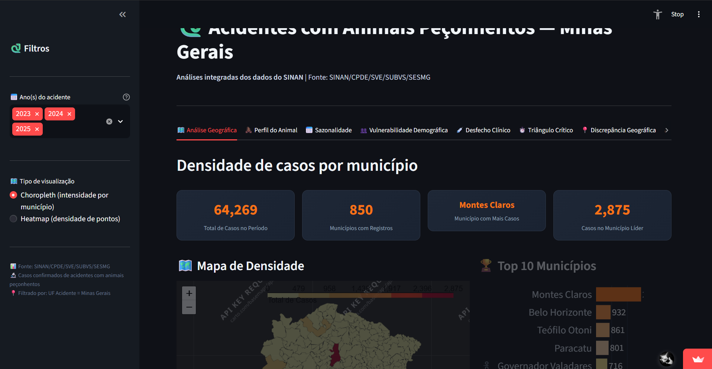

 Dashboard Epidemiológico — Acidentes com Animais Peçonhentos (SINAN / MG)
🔗 **Aplicação ao vivo:** [animaispeconhetosunaaimores.streamlit.app](https://animaispeconhetosunaaimores.streamlit.app/)
> <!--  -->
---
## 🎯 Problema Resolvido
Os registros públicos de notificações epidemiológicas do **SINAN** (Sistema de Informação de Agravos de Notificação) contêm grandes volumes de dados brutos que dificultam a identificação rápida de padrões regionais e sazonais por gestores de saúde e pesquisadores.
Este projeto transforma os dados de acidentes com animais peçonhentos em **Minas Gerais** em um **dashboard analítico interativo multiabas**, permitindo investigar em segundos:
- **Distribuição geográfica** dos casos por município/região (mapas interativos com shapefiles de MG)
- **Sazonalidade** e tendências ao longo do tempo
- **Perfil do animal** envolvido nos acidentes
- **Vulnerabilidade demográfica** dos pacientes
- **Eficácia da soroterapia** e desfechos clínicos
---
## 🛠️ Stack Utilizada
- **Linguagem:** Python
- **Interface Analítica:** Streamlit
- **Processamento de Dados:** Pandas, NumPy, PyArrow
- **Dados Geoespaciais:** GeoPandas, Shapely, PyProj, Folium (`streamlit-folium`)
- **Visualização Interativa:** Plotly
---
## 📂 Estrutura do Projeto
```text
Dashboard-Sinan/
├── app.py              # Ponto de entrada da aplicação Streamlit
├── tabs/               # Abas analíticas modulares do dashboard
├── utils/              # Funções auxiliares de limpeza, carga e processamento
├── data/               # Bases tratadas do SINAN
├── MG_UF_2022/         # Malha geográfica (shapefile) de Minas Gerais (IBGE)
└── requirements.txt    # Dependências Python
```
---
## ▶️ Como Rodar Localmente
```bash
# 1. Clone o repositório
git clone https://github.com/arthuur01/Dashboard-Sinan.git
cd Dashboard-Sinan
# 2. Crie e ative um ambiente virtual (opcional, recomendado)
python -m venv .venv
# Windows:
.venv\Scripts\activate
# Linux/macOS:
source .venv/bin/activate
# 3. Instale as dependências
pip install -r requirements.txt
# 4. Execute o dashboard
streamlit run app.py
```
---
## 👤 Autor & Papel no Projeto
**Arthur Miguel Vieira Mapa** — Desenvolvimento Python/Dados e atuação como **Scrum Master** (facilitação de Daily, Planning, Review, Retrospective e gestão de backlog).  
[LinkedIn](https://linkedin.com/in/arthur-miguel-mapa) | [GitHub](https://github.com/arthuur01)
